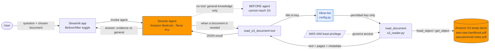

# DocuQuery AI - AWS Exam Knowledge Agent

A weekend MVP for the AWS Builder Center Weekend Challenge. It takes a general
AWS exam-prep agent (built on the **Strands Agents SDK** + **Amazon Bedrock**)
and gives it **exactly one new tool**: an **Amazon S3 document reader**
(`read_s3_document`). With that tool, the agent can answer questions from your
private study PDFs, whitepapers, service guides, and notes stored in S3.

- **Before:** general AWS knowledge only. Cannot read your private documents.
- **After:** reads permitted documents from S3 and answers with page citations,
  clearly separating document evidence from general AWS knowledge.

## What's in the box

```
.
├── app.py                      # Streamlit UI (selector, question, answer, source panel)
├── demo_before_after.py        # Same question, BEFORE vs AFTER the tool (live AWS)
├── docuquery/
│   ├── config.py               # Settings + application-controlled document allow-list
│   ├── s3_reader.py            # read_document(): fetch + validate + pypdf extraction
│   ├── tools.py                # @tool read_s3_document (the one new tool)
│   └── agent.py                # build_base_agent() / build_enhanced_agent()
├── scripts/
│   └── make_sample_pdf.py      # Generate (and optionally upload) a sample study PDF
├── tests/                      # Mocked unit tests (no AWS calls)
├── docs/
│   ├── architecture.md         # Mermaid diagram + request flow
│   ├── architecture.drawio     # draw.io / diagrams.net diagram
│   ├── iam-policy.json         # Least-privilege IAM example
│   ├── demo_script.md          # Two-minute demo walkthrough
│   └── builder_center_draft.md # AWS Builder Center project description draft
├── requirements.txt
├── .env.example
├── LICENSE                     # MIT License
└── pytest.ini
```

## The one new tool: `read_s3_document`

The tool is the heart of the submission. It:

1. Accepts a document **title** from an application-controlled allow-list (in
   `docuquery/config.py`). The model never names a raw bucket or key.
2. Retrieves the object with **boto3** using the configured bucket + region.
3. Validates **file type** (`.pdf`, plus `.txt`/`.md`) and **size** before
   processing.
4. Extracts **PDF text with pypdf**; plain text/Markdown is read directly.
5. Returns extracted text with `[page N]` markers and metadata, **truncated**
   to a configurable character limit.
6. Handles **missing objects, invalid PDFs, encrypted PDFs, empty documents,
   oversized files, and AWS permission errors** as clear, typed results.
7. Enforces the allow-list, so the model **cannot** reach arbitrary buckets/keys.
8. Uses **no hardcoded credentials** - the standard AWS provider chain only.

## Setup

> Prerequisites: Python 3.10+ and (for the live demo) an AWS account with
> Amazon Bedrock model access enabled in your region.

```powershell
# 1. Create and activate a virtual environment
python -m venv .venv
.\.venv\Scripts\Activate.ps1      # Windows PowerShell
# source .venv/bin/activate        # macOS / Linux

# 2. Install dependencies
pip install -r requirements.txt

# 3. Configure environment
copy .env.example .env            # Windows
# cp .env.example .env             # macOS / Linux
# then edit .env: set DOCUQUERY_BUCKET, AWS_REGION, BEDROCK_MODEL_ID
```

### AWS credentials

Use an IAM role or a named profile - do **not** paste long-lived keys into any
committed file. Any of these works (standard boto3 provider chain):

```powershell
# Option A: a named profile
$env:AWS_PROFILE = "your-profile"

# Option B: environment variables (temporary creds preferred)
$env:AWS_ACCESS_KEY_ID = "..."
$env:AWS_SECRET_ACCESS_KEY = "..."
$env:AWS_SESSION_TOKEN = "..."
```

Attach the least-privilege policy in [`docs/iam-policy.json`](docs/iam-policy.json)
(replace the bucket name). It grants read access only to the `study-docs/*`
prefix plus Bedrock invoke.

## Create a sample document (optional but recommended)

This produces a real private PDF so the before/after contrast is genuine:

```powershell
# Write a local sample PDF under sample_docs/
python scripts\make_sample_pdf.py

# Or write it AND upload to your bucket at the catalog key
python scripts\make_sample_pdf.py --upload
```

The sample contains a made-up mnemonic, so an answer that repeats it proves the
agent read *your* document rather than reciting public AWS docs.

## Run it

### Streamlit app

```powershell
streamlit run app.py
```

Pick a document, type a question, toggle **Before/After** in the sidebar, and
click **Ask**. In After mode the source panel shows the document name, key,
page count, and a text preview.

### Before/after demo in the terminal

```powershell
python demo_before_after.py
# or a custom question:
python demo_before_after.py --question "What does my note say about One Zone-IA?"
```

## Tests

The unit tests are **fully mocked** - they use an in-memory fake S3 client and
PDFs generated at runtime, so **no AWS calls are made** and no credentials are
needed.

```powershell
python -m pytest
```

Covered scenarios: successful retrieval + extraction, invalid file type,
missing object, invalid-PDF extraction failure, empty PDF, AWS permission
denial, plus allow-list enforcement, oversized files, output truncation,
encrypted PDFs, and the tool wrapper.

**Last run on this machine:** `12 passed` (Python 3.13, pytest 8.4.2). See
"Verified results" below.

### Mocked vs live

- **Mocked tests** (`tests/`): run offline, assert the reader's logic and error
  handling. These are what `pytest` runs.
- **Live path** (`app.py`, `demo_before_after.py`): makes real Amazon S3 +
  Amazon Bedrock calls. It is **not** asserted in CI and requires real
  credentials, model access, and an uploaded document. No live-integration
  success is claimed here beyond what you verify in your own account.

## Deploy to Streamlit Community Cloud

The app runs on [Streamlit Community Cloud](https://share.streamlit.io) straight
from this public GitHub repo. The main file is **`app.py`**.

> Public-repo security note: Streamlit Cloud has no IAM role, so it needs AWS
> **access keys** in its Secrets store. Do **not** use an admin user. Create a
> dedicated, least-privilege IAM user with the policy in
> [`docs/iam-cloud-user-policy.json`](docs/iam-cloud-user-policy.json) and use
> that user's keys. Rotate and delete them when the demo is done.

Steps:

1. Create the dedicated IAM user (console or CLI) and attach
   `docs/iam-cloud-user-policy.json`. Generate an access key for it.
2. Go to <https://share.streamlit.io> -> **New app** -> pick this repo, branch
   `main`, main file **`app.py`**.
3. Open **Advanced settings -> Secrets** and paste the contents of
   [`.streamlit/secrets.toml.example`](.streamlit/secrets.toml.example),
   replacing the placeholder keys with your dedicated IAM user's credentials.
4. Deploy. Streamlit installs `requirements.txt` and uses the Python version in
   `.python-version` (3.12).

Config and credentials are read via `st.secrets` on Cloud and via `.env` /
the AWS provider chain locally - the same code works in both places
(see `docuquery/config.py`).

**App entry point for the submission field:**
`https://github.com/dineshrajdhanapathyDD/Build-DocuQuery-AI/blob/main/app.py`

## Architecture


> The PNG above is exported from [`docs/architecture.drawio`](docs/architecture.drawio).
> To regenerate it, open the `.drawio` file at [diagrams.net](https://app.diagrams.net)
> and use **File -> Export as -> PNG** (save to `docs/architecture.png`).
> Until the PNG is exported, the GitHub-rendered diagram below shows the same flow.



**Request flow (AFTER / enhanced agent):**

1. The user picks a document (from the allow-list) and asks a question in the
   **Streamlit** UI (hosted on Streamlit Community Cloud).
2. The **Strands** agent, backed by **Amazon Bedrock - Nova Pro**
   (`amazon.nova-pro-v1:0`), decides whether the question needs a document.
3. It calls the one new tool, **`read_s3_document`**, with the document
   **title** (never a raw bucket or key).
4. The **allow-list** in `docuquery/config.py` maps the title to a permitted S3
   key; anything not in the catalog is rejected before any AWS call.
5. `read_document` (in `docuquery/s3_reader.py`) runs the allow-list check, a
   `head_object` size check, type/empty validation, **pypdf** extraction with
   `[page N]` markers, and truncation - returning a typed `DocumentResult`.
6. It reads the object from **Amazon S3** (`study-docs/` prefix:
   `aws-saa-handbook.pdf`, `saa-personal-notes.pdf`) via `get_object`.
7. The agent answers, labeling **document evidence vs general AWS knowledge**;
   the UI shows a source panel with document name, key, and page count.
8. **BEFORE** mode has no tool, so it never reaches S3 - the contrast the demo
   depends on. **AWS IAM** (least privilege) governs the reader: read
   `study-docs/*` + `bedrock:InvokeModel*` on one model, with no hardcoded
   credentials (boto3 provider chain).

The same diagram is also available as a GitHub-rendered Mermaid chart and a
longer request-flow write-up in [`docs/architecture.md`](docs/architecture.md),
with the editable source in [`docs/architecture.drawio`](docs/architecture.drawio).

### Technology stack

| Layer | Technology |
| --- | --- |
| Agent framework | Strands Agents SDK (`@tool` `read_s3_document`) |
| Reasoning model | Amazon Bedrock - Nova Pro (`amazon.nova-pro-v1:0`) |
| Storage | Amazon S3 (`study-docs/` prefix) |
| AWS SDK | boto3 / botocore |
| PDF parsing | pypdf |
| UI / hosting | Streamlit / Streamlit Community Cloud |
| Identity & access | AWS IAM (least-privilege) |
| Runtime / tests | Python 3.12 / pytest (12 mocked tests) |

## Security notes

- Fixed bucket + allow-listed keys: the model cannot choose where to read.
- Least-privilege IAM scoped to one prefix.
- No secrets in the repo; `.env` is git-ignored and `.env.example` has none.
- Type/size/empty validation before and after download; output length capped.

## License

This project is licensed under the **MIT License** - see the [LICENSE](LICENSE)
file for the full text. In short: you may use, copy, modify, and distribute the
code freely, with attribution and no warranty.

Note: study documents under `study-docs/` (and any PDFs in `sample_docs/`) are
**not** covered by this license - they are your own content, are git-ignored,
and are never committed to this repository. Only use study material you have the
right to store and process.

## Deliverables checklist

- [x] Working source code (agent, tool, UI)
- [x] `requirements.txt`
- [x] `.env.example` without secrets
- [x] `README.md` with setup + execution instructions
- [x] Mermaid architecture diagram (`docs/architecture.md`)
- [x] draw.io architecture diagram (`docs/architecture.drawio`)
- [x] IAM permissions example (`docs/iam-policy.json`)
- [x] Unit tests (mocked) - 12 passing
- [x] Two-minute demo script (`docs/demo_script.md`)
- [x] AWS Builder Center project description draft (`docs/builder_center_draft.md`)
- [x] Open-source license (`LICENSE` - MIT)
```
