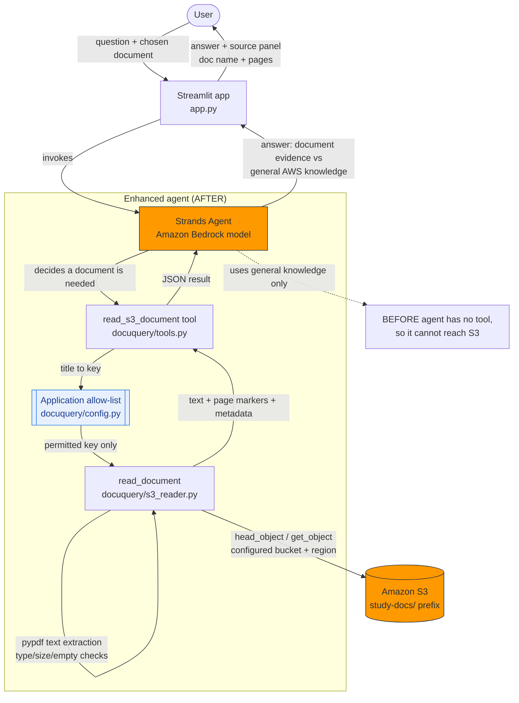

# DocuQuery AI - Architecture

## Mermaid diagram

## How the request flows

1. The user picks a document (from the allow-list) and types a question in the
   Streamlit UI.
2. The Strands agent (backed by an Amazon Bedrock model) decides whether the
   question needs a document.
3. If so, it calls the single new tool, `read_s3_document`, with the document
   **title** (never a raw key or bucket).
4. `config.key_for_title` maps the title to an approved S3 key. Any title or
   key not in the catalog is rejected before any AWS call.
5. `read_document` validates type and size, fetches the object from the
   configured bucket/region with boto3, extracts text with pypdf, and returns
   text (with `[page N]` markers) plus metadata, truncated to a length limit.
6. The agent composes an answer that labels document evidence separately from
   general AWS knowledge, and the UI shows a source panel with the document
   name and page references.

## Security boundaries

- **Bucket is fixed** in configuration; the model cannot change it.
- **Keys are allow-listed**; the model selects by title only.
- **No hardcoded credentials** - boto3's standard provider chain (IAM role,
  profile, env vars, SSO) supplies credentials.
- **Least privilege IAM** - read only the `study-docs/*` prefix plus Bedrock
  invoke (see `docs/iam-policy.json`).
